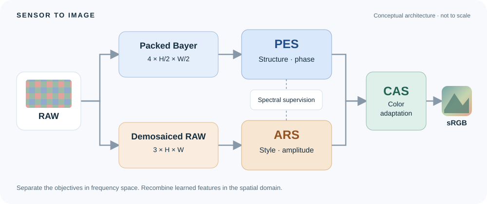

<div align="center">

# FourierISP

### Enhancing RAW-to-sRGB with Decoupled Style Structure in Fourier Domain

**AAAI 2024 · Official PyTorch implementation**

Xuanhua He\*, Tao Hu\*, Guoli Wang, Zejin Wang, Run Wang, Qian Zhang, Keyu Yan, Ziyi Chen, Rui Li, Chengjun Xie, Jie Zhang†, Man Zhou†

\* Equal contribution · † Corresponding authors

[Paper (AAAI)](https://doi.org/10.1609/aaai.v38i3.27985) · [arXiv](https://arxiv.org/abs/2401.02161) · [Modern API documentation](modern/README.md) · [Project page](https://alexhe101.github.io/FourierISP/)

[](https://github.com/alexhe101/FourierISP/actions/workflows/fourierisp-modern.yml)

</div>



## Overview

FourierISP learns smartphone RAW-to-sRGB mapping by assigning spatial restoration and color enhancement to distinct frequency-domain pathways. A phase enhancement subnet (PES) learns structure, an amplitude refinement subnet (ARS) learns style, and a color adaptation subnet (CAS) combines the learned features into the final image.

This repository includes both the original AAAI 2024 BasicSR implementation and **FourierISP Modern**, an additive standalone PyTorch implementation designed to preserve the active computation of the original network.

## Updates

- **2026-11:** Modular PyTorch package, mixed-precision-safe Fourier operations, legacy weight migration, command-line inference and benchmarks, automated CPU regression tests, and a project website.
- **2024:** Original AAAI paper and training code released.

## Published results

The numbers below are from Table 1 of the [AAAI 2024 paper](https://arxiv.org/html/2401.02161v1#S4), not a new evaluation of the modern implementation.

| Dataset / protocol | PSNR ↑ | SSIM ↑ | MS-SSIM ↑ | LPIPS ↓ |
|:--|--:|--:|--:|--:|
| ZRR | 21.65 | 0.7546 | 0.8660 | 0.1820 |
| ZRR (aligned GT) | 23.93 | 0.8744 | 0.9461 | 0.1240 |
| MAI (one epoch of fine-tuning) | 24.99 | 0.8820 | 0.9594 | 0.0850 |

See the paper for baseline comparisons, qualitative images, and evaluation details.

## Quick start — modern PyTorch

Requires Python 3.10+ and PyTorch 2.4+. Install the appropriate PyTorch build for your device, then:

```bash
git clone https://github.com/alexhe101/FourierISP.git
cd FourierISP
python -m venv .venv
source .venv/bin/activate
python -m pip install -e './modern[dev]'
python -m pytest modern/tests -q -rs
```

```python
import torch
from fourierisp import FourierISP
from fourierisp.checkpoint import load_weights

model = FourierISP(width=24, depth=4).eval()
# load_weights(model, "your_checkpoint.pth")

raw = torch.rand(1, 4, 112, 112)
demo = torch.rand(1, 3, 224, 224)
with torch.inference_mode():
    result = model(raw, demo)

print(result.srgb.shape)  # torch.Size([1, 3, 224, 224])
```

The example uses random inputs and randomly initialized weights only to verify the API. Real inference requires trained weights. Packed RAW and demosaiced RGB must originate from the same input mosaic; follow the [input conventions](modern/README.md#architecture).

```bash
fourierisp convert --checkpoint legacy.pth --output modern.pth
fourierisp infer --checkpoint modern.pth --input example.npz --output result.png
fourierisp benchmark --device cuda --height 448 --image-width 448 --amp
```

## Training and datasets

The original training configuration and source remain available. Install the upstream BasicSR dependencies separately and set the dataset paths in the YAML configuration.

```bash
# Original research implementation
python basicsr/train.py -opt options/train/FourierISP/train_FourierISP.yml

# Modern architecture using the original BasicSR training objective
python basicsr/train.py -opt options/train/FourierISP/train_FourierISPModern.yml
```

- **ZRR (Zurich RAW-to-RGB):** primary training dataset; use the unaligned protocol or optical-flow-aligned ground truth as described in the paper. For dataset alignment, the original repository recommends AlignFormer or LiteISP.
- **MAI:** transfer evaluation in the paper uses one epoch of fine-tuning.
- **Weights:** the original release does not provide a public checkpoint. Train a model or convert your own compatible legacy weights. No pretrained weights are included.

## Repository layout

| Path | Purpose |
|:--|:--|
| [modern/src/fourierisp/](modern/src/fourierisp/) | Standalone PyTorch model, Fourier operators, preprocessing and CLI |
| [modern/tests/](modern/tests/) | Unit tests and numerical parity with the original architecture |
| [modern/README.md](modern/README.md) | Detailed usage, tensor conventions and migration guide |
| [basicsr/archs/FourierISP_arch.py](basicsr/archs/FourierISP_arch.py) | Original AAAI architecture (unchanged) |
| [basicsr/archs/FourierISPModern_arch.py](basicsr/archs/FourierISPModern_arch.py) | Optional BasicSR compatibility adapter |
| [options/train/FourierISP/](options/train/FourierISP/) | Original and modern training configurations |
| [docs/](docs/) | Static research project website |

## Validation and limitations

The modern package has passed [CPU CI on Python 3.10 and 3.12](https://github.com/alexhe101/FourierISP/actions/runs/45541148605): 14 tests passed and 1 CUDA test skipped on each environment. Tests cover checkpoint migration, configurable depth, BF16 CPU autocast, and numerical parity against the untouched legacy architecture on synthetic inputs. Real checkpoint quality, CUDA performance, and full training reproduction have not yet been verified. No new PSNR or speedup is claimed.

## Citation

If you use FourierISP in your research, please cite the original paper:

```bibtex
@inproceedings{he2024fourierisp,
  title     = {Enhancing RAW-to-sRGB with Decoupled Style Structure in Fourier Domain},
  author    = {He, Xuanhua and Hu, Tao and Wang, Guoli and Wang, Zejin and
               Wang, Run and Zhang, Qian and Yan, Keyu and Chen, Ziyi and
               Li, Rui and Xie, Chengjun and Zhang, Jie and Zhou, Man},
  booktitle = {Proceedings of the AAAI Conference on Artificial Intelligence},
  volume    = {38},
  number    = {3},
  pages     = {2130--2138},
  year      = {2024},
  doi       = {10.1609/aaai.v38i3.27985}
}
```
